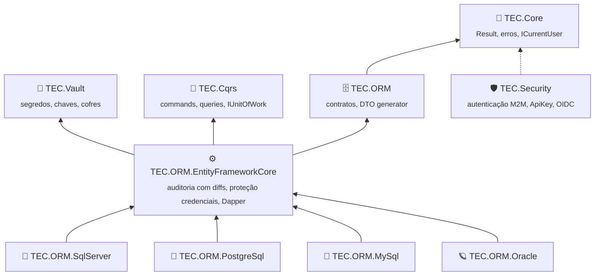

<div align="center">


# 🗄️ TEC.ORM

**Persistência padronizada, agnóstica e segura por padrão: CRUD para qualquer entidade, consultas SQL via Dapper, suporte a SQL Server, PostgreSQL, MySQL e Oracle, trilha histórica de auditoria com diffs, exclusão lógica e conversão entidade ↔ DTO gerada na compilação, com credenciais lidas exclusivamente de cofres.**

EF Core · Dapper · Multi-Banco (SQL Server · PostgreSQL · MySQL · Oracle) · `Result` em vez de exceção · Trilha Histórica com Diffs · Mascaramento de Dados Sensíveis · Proteção Estrita de Connection String · Exclusão lógica · Auditoria M2M & ApiKey · Source Generator · .NET 10

[](https://github.com/tudoemcodigo/lib-tec-orm/actions/workflows/ci.yml)
[](#-compatibilidade)
[](#-compatibilidade)
[](CHANGELOG.md)
[](LICENSE)

[📥 Instalação](#-instalação) · [🚀 Início rápido](#-início-rápido) · [🛡️ Trilha de Auditoria & Segurança](#️-trilha-de-auditoria--segurança) · [📚 Documentação](docs/README.md) · [📝 Changelog](CHANGELOG.md) · [⚙️ CI/CD](.github/workflows/README.md)

</div>

---

## 📑 Sumário

- [✨ Por que usar](#-por-que-usar)
- [📦 Pacotes](#-pacotes)
- [🧬 Ecossistema TEC](#-ecossistema-tec)
- [📥 Instalação](#-instalação)
- [🚀 Início rápido](#-início-rápido)
  - [1. SQL Server](#1-sql-server)
  - [2. PostgreSQL](#2-postgresql)
  - [3. MySQL](#3-mysql)
  - [4. Oracle](#4-oracle)
- [🛡️ Trilha de Auditoria & Segurança](#️-trilha-de-auditoria--segurança)
  - [Auditoria com Diffs (`OldValues` / `NewValues`)](#auditoria-com-diffs-oldvalues--newvalues)
  - [Suporte a Atores M2M e ApiKey](#suporte-a-atores-m2m-e-apikey)
  - [Proteção Estrita de Connection String](#proteção-estrita-de-connection-string)
- [⚡ Compatibilidade](#-compatibilidade)
- [🧪 Testes](#-testes)
- [🤝 Contribuição](#-contribuição)
- [🏷️ Versionamento](#️-versionamento)
- [📄 Licença](#-licença)

---

## ✨ Por que usar

| Sem o TEC.ORM | Com o TEC.ORM |
|---|---|
| Repositórios e consultas acoplados a um provedor específico | Camada agnóstica (`TEC.ORM.EntityFrameworkCore`) com provedores especializados para **SQL Server**, **PostgreSQL**, **MySQL** e **Oracle** |
| Um repositório escrito à mão por entidade | Um único `IOrmRepository<TEntity, TKey>` para qualquer entidade e tipo de chave |
| Consultas de alta performance exigem abrir mão de governança | Suporte nativo a **Dapper** (`IOrmQueryExecutor`) com validação de leitura estrita e sanitização |
| Auditoria rasa que salva apenas quem alterou | **Trilha Histórica Completa** (`OrmAuditRecord`): grava diffs (`OldValues`, `NewValues`, `AffectedColumns`) ativada por `[Auditable]`, com mascaramento automático de `[SensitiveData]` |
| Falta de rastreio para integrações e jobs em segundo plano | Auditoria de atores humanos (`User`), integrações Machine-to-Machine (`M2M`), `ApiKey`, rotinas (`System`) e `Anonymous`, com `TraceId`, `IP` e `Endpoint` |
| Strings de conexão vazando em logs, depuradores ou exceções | `ProtectedConnectionString` com `[DebuggerDisplay("***")]`, `[DebuggerBrowsable(Never)]` e `[EditorBrowsable(Never)]`: conexão nunca vaza |
| Exceções de banco vazando até a API | Todo método devolve `Result` com os códigos unificados de `OrmErrors` |
| `WHERE IsDeleted = 0` esquecido; `DELETE` físico por engano | Exclusão lógica automática com filtro global; exclusão física só explícita |
| Código de cópia entidade ↔ DTO por reflexão | `[MapFrom]` e o gerador Roslyn compila a projeção otimizada em tempo de compilação sem reflexão |

---

## 📦 Pacotes

| Pacote | Para que serve | Onde instalar |
|---|---|---|
| [`TEC.ORM`](TEC.ORM/README.md) | Contratos fundamentais (`IOrmRepository`, `IOrmQueryExecutor`, `SqlQuery`, `OrmErrors`), atributos de auditoria (`[Auditable]`, `[SensitiveData]`, `[AuditIgnore]`) e gerador Roslyn DTO | Domínio, Aplicação |
| [`TEC.ORM.EntityFrameworkCore`](TEC.ORM.EntityFrameworkCore/README.md) | Núcleo base agnóstico: interceptor de auditoria com diffs, proteção de connection string, repositório genérico, executor Dapper, idempotência e abstrações de dialetos | Infraestrutura |
| [`TEC.ORM.SqlServer`](TEC.ORM.SqlServer/README.md) | Provedor especialista para **Microsoft SQL Server** e **Azure SQL** | Infraestrutura / Host |
| [`TEC.ORM.PostgreSql`](TEC.ORM.PostgreSql/README.md) | Provedor especialista para **PostgreSQL** (Npgsql) | Infraestrutura / Host |
| [`TEC.ORM.MySql`](TEC.ORM.MySql/README.md) | Provedor especialista para **MySQL / MariaDB** (`MySql.EntityFrameworkCore`, com o driver MySql.Data também no Dapper) | Infraestrutura / Host |
| [`TEC.ORM.Oracle`](TEC.ORM.Oracle/README.md) | Provedor especialista para **Oracle Database** (`Oracle.EntityFrameworkCore`) | Infraestrutura / Host |

---

## 🧬 Ecossistema TEC



---

## 📥 Instalação

Adicione a origem interna do NuGet e instale o pacote correspondente ao seu banco:

```bash
# SQL Server
dotnet add package TEC.ORM.SqlServer --version 0.0.1

# PostgreSQL
dotnet add package TEC.ORM.PostgreSql --version 0.0.1

# MySQL
dotnet add package TEC.ORM.MySql --version 0.0.1

# Oracle
dotnet add package TEC.ORM.Oracle --version 0.0.1

# Domínio / Aplicação (AOT-ready, sem drivers de banco)
dotnet add package TEC.ORM --version 0.0.1
```

---

## 🚀 Início rápido

### 1. SQL Server

```csharp
using TEC.ORM.SqlServer.DependencyInjection;

builder.Services.AddTecVault(vault => vault.UseAzureKeyVault(...));
builder.Services.AddTecOrmSqlServer<AppDbContext>(orm =>
{
    orm.ConnectionSecretName = "sqlserver-rw";
    orm.ReadOnlyConnectionSecretName = "sqlserver-ro";
});
```

### 2. PostgreSQL

```csharp
using TEC.ORM.PostgreSql.DependencyInjection;

builder.Services.AddTecVault(vault => vault.UseAzureKeyVault(...));
builder.Services.AddTecOrmPostgreSql<AppDbContext>(orm =>
{
    orm.ConnectionSecretName = "postgres-rw";
    orm.ReadOnlyConnectionSecretName = "postgres-ro";
});
```

### 3. MySQL

```csharp
using TEC.ORM.MySql.DependencyInjection;

builder.Services.AddTecVault(vault => vault.UseAzureKeyVault(...));
builder.Services.AddTecOrmMySql<AppDbContext>(orm =>
{
    orm.ConnectionSecretName = "mysql-rw";
    orm.ReadOnlyConnectionSecretName = "mysql-ro";
});
```

### 4. Oracle

```csharp
using TEC.ORM.Oracle.DependencyInjection;

builder.Services.AddTecVault(vault => vault.UseAzureKeyVault(...));
builder.Services.AddTecOrmOracle<AppDbContext>(orm =>
{
    orm.ConnectionSecretName = "oracle-rw";
    orm.ReadOnlyConnectionSecretName = "oracle-ro";
});
```

---

## 🛡️ Trilha de Auditoria & Segurança

### Auditoria com Diffs (`OldValues` / `NewValues`)

Basta anotar a entidade com `[Auditable]`. O interceptor grava cada alteração na tabela da trilha (`OrmOptions.AuditLogTableName`, padrão `OrmAuditRecords`) na mesma transação do salvamento. Quando a chave é gerada pelo banco (identity), o registro sai depois do `INSERT`, ainda na mesma transação, já com a chave real.

```csharp
using TEC.ORM.Auditing;
using TEC.ORM.Entities;

[Auditable]
public sealed class Contrato : AuditableEntity<Guid>
{
    public string Numero { get; set; } = string.Empty;
    public decimal Valor { get; set; }

    [SensitiveData]
    public string ChaveAssinatura { get; set; } = string.Empty; // Gravado como "***" nos diffs

    [AuditIgnore]
    public string CacheCalculado { get; set; } = string.Empty;  // Ignorado da auditoria
}
```

No modelo do contexto:
```csharp
protected override void OnModelCreating(ModelBuilder modelBuilder)
{
    base.OnModelCreating(modelBuilder);
    modelBuilder.AddTecOrmHistoricalAudit(); // Mapeia OrmAuditRecord e índices otimizados
}
```

### Suporte a Atores M2M e ApiKey

O `DefaultOrmAuditContextProvider` identifica e grava usuários, integrações e processos não supervisionados. O registro de cada provedor (`AddTecOrm`, `AddTecOrmPostgreSql`, `AddTecOrmMySql`, `AddTecOrmOracle`) já o configura com o `ICurrentUser` da operação, o mesmo das colunas de autoria; para trocar, registre o seu `IOrmAuditContextProvider` antes:

- **`User`**: Requisições de usuários finais autenticados.
- **`M2M`**: Requisições Machine-to-Machine com Client Credentials via `TEC.Security`.
- **`ApiKey`**: Requisições autenticadas por Chave de API, capturando o identificador da chave.
- **`System`**: Background Workers, filas, schedulers e rotinas automáticas de manutenção.
- **`Anonymous`**: Acessos não autenticados (rejeitados por padrão se a entidade exigir auditoria fechada).

Todas as operações capturam o `TraceId` ativo (`Activity.Current`), `CorrelationId`, `ClientIp` e `Endpoint`.

### Proteção Estrita de Connection String

O `ProtectedConnectionString` encapsula as credenciais obtidas dos cofres:
- **`ToString()`**: Retorna invariavelmente `"***"`.
- **Debugger**: Ocultado com `[DebuggerDisplay("***")]` e `[DebuggerBrowsable(DebuggerBrowsableState.Never)]`.
- **IntelliSense**: Ocultado via `[EditorBrowsable(EditorBrowsableState.Never)]`.
- **Driver ADO.NET**: O valor puro só sai por `Reveal()`, usado na atribuição ao driver. A string fica em memória como texto comum: não há criptografia em memória.
- **Logs**: O TEC.ORM registra só o tipo da exceção de conexão e o código de erro do banco, sem `Message`. O registro de todos os provedores também desliga `EnableSensitiveDataLogging` e os eventos de erro do EF Core que repetiriam a mensagem do banco.

---

## ⚡ Compatibilidade

| Item | Suporte |
|---|---|
| .NET | `net10.0` (LTS), com EF Core 10 |
| Bancos suportados | Microsoft SQL Server / Azure SQL, PostgreSQL, MySQL 8+ / MariaDB, Oracle Database. No Oracle, o DDL gerado pelo provedor usa por padrão a compatibilidade do 23ai (colunas `BOOLEAN`); para 19c ou 21c, passe `UseOracleSQLCompatibility` no registro |
| Native AOT / Trimming | ✅ `TEC.ORM` (domínio, contratos e DTOs) |
| Consultas de Alta Performance | **Dapper** via `IOrmQueryExecutor` em todos os provedores, com o prefixo de parâmetro do banco (`:p0` no Oracle, `@p0` nos demais) e transação somente leitura no PostgreSQL, MySQL e Oracle ([📊 Consultas SQL](docs/consultas-sql.md)) |
| Compilador | .NET SDK 10 (os pacotes são só `net10.0`). O gerador de DTO roda a partir do Roslyn 4.12, mas esse piso não basta para consumir os pacotes |

> [!NOTE]
> **PostgreSQL, MySQL e Oracle: suporte implementado, validação de integração pendente.** Os três usam o mesmo pipeline do
> SQL Server (identidade da auditoria, ordem dos interceptores, convenções, logs sem dados sensíveis, tempo limite dos
> comandos, tradução de erros e mapeador do TEC.Cqrs), com testes unitários e de registro no container. Os testes de
> integração contra cada banco existem, mas só rodam com a conexão configurada ([🧪 Testes](docs/testes.md)) e ainda não
> foram executados contra PostgreSQL, MySQL ou Oracle reais. Detalhes em
> [🛡️ Segurança](docs/seguranca.md#provedores-postgresql-mysql-e-oracle).

---

## 🧪 Testes

```bash
# Testes unitários
dotnet test --project TEC.ORM.Tests -c Release --treenode-filter "/*/*/*/*[Category!=Integracao]"

# Testes de integração (SQL Server; PostgreSQL, MySQL e Oracle quando as conexões estão configuradas)
dotnet test --project TEC.ORM.Tests -c Release --treenode-filter "/*/*/*/*[Category=Integracao]"
```

- A contagem de testes sai do próprio `dotnet test` (ela varia por categoria); este README não fixa um número.
- Cobertura de trilha histórica, diffs, atores (User, M2M, ApiKey, System), mascaramento sensível, proteção de credenciais, dialetos e registro de cada provedor. O CI testa o banco real só no SQL Server; os testes de integração do PostgreSQL, MySQL e Oracle se pulam sem as variáveis `TEC_TESTES_ORM_PG_CONEXAO`, `TEC_TESTES_ORM_MYSQL_CONEXAO` e `TEC_TESTES_ORM_ORACLE_CONEXAO`.

---

## 🤝 Contribuição

Branch a partir da `main` → código **e** testes unitários → `dotnet test` → pull request com CI verde.

---

## 🏷️ Versionamento

[SemVer](https://semver.org/lang/pt-BR/), publicado no feed oficial Tudo em Código.

---

## 📄 Licença

[Apache 2.0](LICENSE) · Criado e mantido por **Roberto Oliveira**, equipe **Tudo em Código** · [github.com/tudoemcodigo](https://github.com/tudoemcodigo)
