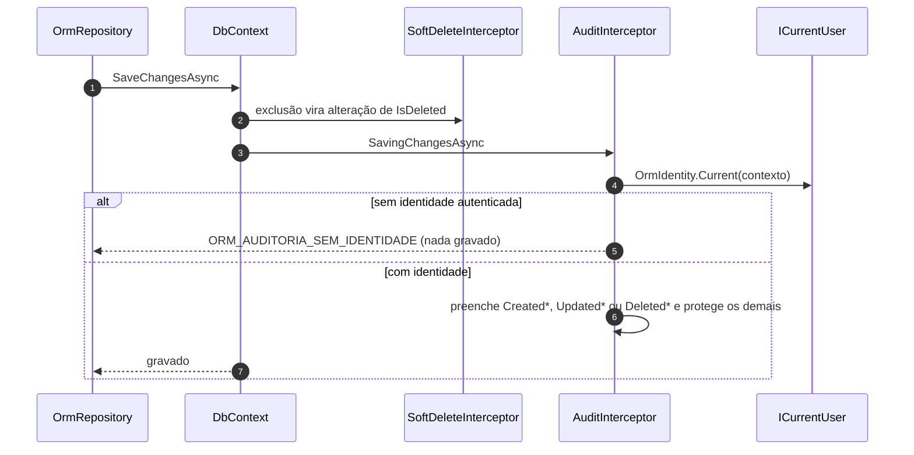

[🏠 TEC.ORM](../README.md) › [📚 Documentação](README.md) › 🕵️ Auditoria

# 🕵️ Auditoria

> Quem criou, alterou e excluiu cada registro, de qual tenant e quando, gravado pelo próprio ORM a partir do
> `ICurrentUser` do TEC.Core, com falha fechada quando não há identidade.

## 📑 Sumário

- [🎯 Visão geral](#-visão-geral)
- [🚀 Uso](#-uso)
  - [IAuditable e AuditableEntity](#iauditable-e-auditableentity)
  - [Configuração por cenário](#configuração-por-cenário)
  - [OrmIdentity e UseTecOrmIdentity](#ormidentity-e-usetecormidentity)
  - [Regras ao gravar](#regras-ao-gravar)
  - [Migração do banco](#migração-do-banco)
- [⚙️ Opções](#️-opções)
- [❌ Erros](#-erros)
- [🛡️ Segurança](#️-segurança)
- [❓ Perguntas frequentes](#-perguntas-frequentes)

---

## 🎯 Visão geral

O TEC.ORM **não depende** do TEC.Security: qualquer implementação de `ICurrentUser` (TEC.Core, `TEC.Core.Security`) serve.
O [TEC.Security](https://github.com/tudoemcodigo/lib-tec-security) registra a dele, inclusive para workers.

| Operação | Quando | Quem (`ICurrentUser.Id`) | Tenant de quem fez (`ICurrentUser.TenantId`) |
|---|---|---|---|
| Criação | `CreatedAt` | `CreatedBy` | `CreatedByTenant` |
| Última alteração | `UpdatedAt` | `UpdatedBy` | `UpdatedByTenant` |
| Exclusão lógica | `DeletedAt` (de `ISoftDelete`) | `DeletedBy` | `DeletedByTenant` |



> [!IMPORTANT]
> **Os registros são globais.** O tenant é só informação de auditoria: o ORM **não** filtra consultas nem restringe
> gravações por tenant ou usuário. Quem pode ler ou alterar o quê é decidido pela aplicação.

---

## 🚀 Uso

### IAuditable e AuditableEntity

> `TEC.ORM.Entities` · `interface IAuditable` / `abstract class AuditableEntity<TKey>` · pacote `TEC.ORM`

| Membro | Tipo | Descrição |
|---|---|---|
| `CreatedAt` | `DateTimeOffset` | Quando foi criada (UTC) |
| `CreatedBy` / `CreatedByTenant` | `string?` | Id e tenant de quem criou |
| `UpdatedAt` | `DateTimeOffset?` | Última alteração (UTC); `null` se nunca foi alterada |
| `UpdatedBy` / `UpdatedByTenant` | `string?` | Id e tenant de quem alterou por último |
| `DeletedBy` / `DeletedByTenant` | `string?` | Id e tenant de quem excluiu logicamente |

`AuditableEntity<TKey>` = `Entity<TKey>` + `IAuditable`, todos com `set` privado.

```csharp
using TEC.ORM.Entities;

public sealed class Order : AuditableEntity<Guid>
{
    public string Number { get; set; } = string.Empty;
}

// Database first: a entidade gerada implementa as interfaces numa partial
public partial class Product : IEntity<int>, ISoftDelete, IAuditable { }
```

Os "por" guardam `ICurrentUser.Id`: identificador **estável** (`oid` do Entra ID, `apikey:{id}`, `system:{nome}`), nunca
nome ou e-mail. O mapeamento gerado (`ApplyTo`/`ToEntity`) nunca copia esses campos.

### Configuração por cenário

| Cenário | O que fazer |
|---|---|
| Contexto registrado com `AddTecOrm<TContext>` (ou `AddTecOrmPostgreSql`, `AddTecOrmMySql`, `AddTecOrmOracle`) | Nada: o contexto recebe o `ICurrentUser` **do escopo de DI** (o mesmo da requisição) |
| `AddDbContextFactory` ou contexto montado à mão com `optionsBuilder.UseTecOrm(provider)` | Nada para `ICurrentUser` **ambiental** (as implementações do TEC.Security leem o usuário do `HttpContext` ou do `AsyncLocal`): a cada gravação o `UseTecOrm` resolve o `ICurrentUser` num escopo próprio e guarda uma **cópia imutável** (tipo, id e tenant) antes de descartar o escopo |
| `ICurrentUser` que depende de **estado do escopo da requisição** (preenchido por um middleware num serviço *scoped*, por exemplo) | Chame `UseTecOrmIdentity(() => ...)` **depois** do `UseTecOrm`, entregando a identidade certa |
| Testes, ferramentas, importadores | `UseTecOrmIdentity(() => systemUser)` com uma identidade de sistema (`Id = "system:importador"`) |

> [!WARNING]
> Com `UseTecOrm`, o `ICurrentUser` resolvido num escopo novo **não** enxerga o estado *scoped* da requisição. Se a sua
> implementação depende dele, use `UseTecOrmIdentity`; senão a gravação falha com `ORM_AUDITORIA_SEM_IDENTIDADE` (falha
> fechada, nunca grava a identidade errada).

```csharp
using TEC.ORM.EntityFrameworkCore.Auditing;
using TEC.ORM.SqlServer.DependencyInjection;

builder.Services.AddDbContextFactory<ReportsContext>((sp, options) => options
    .UseTecOrm(sp)                                                  // pipeline e conexão do contexto principal
    .UseTecOrmIdentity(() => sp.GetRequiredService<IHttpContextAccessor>().HttpContext?.RequestServices
        .GetService<ICurrentUser>()));                              // identidade do escopo da requisição atual
```

### OrmIdentity e UseTecOrmIdentity

> `TEC.ORM.EntityFrameworkCore.Auditing` · `static class OrmIdentity` · pacote `TEC.ORM.EntityFrameworkCore` (o mesmo nos quatro provedores)

| Membro | Retorno | Descrição |
|---|---|---|
| `Current(DbContext context)` | `ICurrentUser?` | Identidade atual do contexto; `null` se ele não foi configurado pelo TEC.ORM ou não há `ICurrentUser` |
| `UseTecOrmIdentity(this DbContextOptionsBuilder builder, Func<ICurrentUser?> currentUser)` | `DbContextOptionsBuilder` | Informa de onde vem a identidade; a função é chamada **a cada gravação** |

```csharp
var options = new DbContextOptionsBuilder<SalesContext>()
    .UseTecOrm(provider)                         // requer AddTecOrm no provider
    .UseTecOrmIdentity(() => systemUser)         // ICurrentUser com Id "system:importador"
    .Options;

await using var db = new SalesContext(options);
ICurrentUser? current = OrmIdentity.Current(db);
```

### Regras ao gravar

Nos quatro provedores, o `AuditInterceptor` (interno) roda **depois** do interceptor de exclusão lógica e **antes** da
trilha histórica, para toda entidade `IAuditable` adicionada, alterada ou excluída:

| Situação | Comportamento |
|---|---|
| Sem identidade autenticada (`ICurrentUser` ausente, anônimo ou sem `Id`) | **Recusa** com `ORM_AUDITORIA_SEM_IDENTIDADE`; nada é gravado |
| Criação | `CreatedAt`/`CreatedBy`/`CreatedByTenant` do relógio (`TimeProvider`) e da identidade; o que vier no objeto é ignorado; campos de alteração e exclusão zerados |
| Alteração | Grava `UpdatedAt`/`UpdatedBy`/`UpdatedByTenant`; criação e exclusão ficam fora do `UPDATE` |
| Exclusão lógica | Grava `DeletedBy`/`DeletedByTenant`; os de alteração ficam fora do `UPDATE` |
| Identidade sem tenant | Grava com os "por tenant" `null` |

### Trilha Histórica de Auditoria (Audit Trail / Diffs)

> `TEC.ORM.Auditing` · `class OrmAuditRecord` · atributos `[Auditable]`, `[SensitiveData]`, `[AuditIgnore]` · `HistoricalAuditInterceptor`

Além da auditoria cadastral de entidade (`IAuditable`), o TEC.ORM oferece a gravação completa da **trilha histórica com diffs atômicos** na mesma transação da gravação:
- **`[Auditable]`**: Anote a classe de domínio para habilitar o rastreamento histórico de alterações.
- **`[SensitiveData]`**: Propriedades anotadas têm seus valores mascarados como `***` nos JSONs de histórico (`OldValues` e `NewValues`).
- **`[AuditIgnore]`**: Propriedades anotadas são completamente omitidas do log de diffs.
- **Mapeamento da Tabela**: No método `OnModelCreating` do seu `DbContext`, configure a tabela com `modelBuilder.AddTecOrmHistoricalAudit()`. Sem nome explícito, a tabela é a de `OrmOptions.AuditLogTableName` (padrão `OrmAuditRecords`); um nome passado ao `AddTecOrmHistoricalAudit("Trilha", "auditoria")` sempre vence.

```csharp
using TEC.ORM.Auditing;
using TEC.ORM.Entities;

[Auditable]
public sealed class Customer : AuditableEntity<Guid>
{
    public string Name { get; set; } = string.Empty;

    [SensitiveData]
    public string DocumentNumber { get; set; } = string.Empty;

    [AuditIgnore]
    public string CacheKey { get; set; } = string.Empty;
}

// Configuração no DbContext
protected override void OnModelCreating(ModelBuilder modelBuilder)
{
    base.OnModelCreating(modelBuilder);
    modelBuilder.AddTecOrmHistoricalAudit(); // Mapeia OrmAuditRecords com índices
}
```

O `OrmAuditRecord` registra de forma imutável:
- `Action`: `Created`, `Updated`, `Deleted` ou `SoftDeleted`.
- `OldValues` / `NewValues` / `AffectedColumns`: Dicionários serializados em JSON com as alterações.
- `ActorId`, `ActorType` (`User`, `M2M`, `ApiKey`, `System`, `Anonymous`), `ActorName`, `TenantId`, `TraceId`, `CorrelationId`, `ClientIp`, `Endpoint` e `TimestampUtc`.

Como a trilha é gravada, conforme o código do `HistoricalAuditInterceptor`:

- **Ordem:** a trilha roda depois da autoria e da exclusão lógica, então registra os valores carimbados (`CreatedBy`, `DeletedBy`...) e não os que o chamador enviou. Uma exclusão lógica gera `SoftDeleted`.
- **Ator:** vem do `IOrmAuditContextProvider`. O registro de cada provedor configura o `DefaultOrmAuditContextProvider` com o `ICurrentUser` da operação (a mesma identidade de `UseTecOrmIdentity`, que preenche as colunas de autoria). Para trocar, registre o seu `IOrmAuditContextProvider` antes do `AddTecOrm*`.
- **Chave gerada pelo banco:** a inclusão com chave `int`/`long` gerada pelo banco é registrada **depois** do `INSERT`, já com o `Id` gravado. Para isso o interceptor abre uma transação se não houver uma (do contexto ou ambiente) e confirma a trilha junto com a gravação; se o salvamento falhar ou for cancelado, ela é desfeita.
- **Exclusão física:** em entidade `[Auditable]`, `HardDeleteAsync` lê a linha antes do `DELETE` e grava um `Deleted` com os valores antigos, na mesma transação. Por especificação, lê até `MaxFindResults` linhas e as remove uma a uma pela chave; acima disso devolve `ORM_LIMITE_EXCEDIDO` sem excluir nada.
- **Tamanho:** cada valor é cortado em `OrmOptions.MaxAuditValueLength` caracteres (padrão 1.024), com a marca `…(+N)` do que sobrou; `byte[]` vira `<N bytes>`. Textos curtos (`EntityName`, `ActorName`, `Endpoint`...) são ajustados ao tamanho da coluna. Marque colunas grandes que não interessam à auditoria com `[AuditIgnore]`.
- **Oracle:** `OldValues`, `NewValues` e `AffectedColumns` vão em `NCLOB` (o padrão do provedor do Oracle para texto sem tamanho é `NVARCHAR2(2000)`, que faria o salvamento falhar com alterações maiores).
- **Valores `[SensitiveData]`:** viram `***` nos diffs, mas a chave primária não é mascarada em `EntityKey`.

### Migração do banco

A convenção (aplicada por `AddTecOrm`/`UseTecOrm`, `OrmDbContext` e `AddTecOrmConventions`) define, quando a entidade não
define outro tamanho, `CreatedBy`/`UpdatedBy`/`DeletedBy` com até 256 caracteres e os `*ByTenant` com até 64, todas
anuláveis. Em tabelas existentes, adicione as colunas com valor inicial (`CreatedAt` = data da migração, `CreatedBy` =
`system:migracao`) antes de trocar a base da entidade.

---

## ⚙️ Opções

O relógio é o `TimeProvider` registrado e a identidade é a de `UseTecOrmIdentity` (o `AddTecOrm*` e o `UseTecOrm` a
configuram). Para a trilha histórica:

| Opção | Padrão | Efeito |
|---|---|---|
| `EnableHistoricalAudit` | `true` | Liga a trilha das entidades `[Auditable]` |
| `AuditLogTableName` | `OrmAuditRecords` | Nome da tabela quando o `AddTecOrmHistoricalAudit` não recebe um (até 128 caracteres) |
| `MaxAuditValueLength` | `1024` | Tamanho máximo de cada valor nos diffs (de 64 a 1.048.576) |

---

## ❌ Erros

| Código | Quando ocorre | O que fazer |
|---|---|---|
| `ORM_AUDITORIA_SEM_IDENTIDADE` (HTTP 401) | Escrita de entidade auditada sem identidade autenticada | Autenticar a requisição; em workers, usar identidade de sistema ou `UseTecOrmIdentity` |

---

## 🛡️ Segurança

- **Falha fechada:** sem identidade, nada é gravado (nunca "anônimo").
- **Sem autoria forjada:** valores enviados no objeto são ignorados; os campos de criação nunca entram no `UPDATE`, e o
  objeto devolvido pelo `UpdateAsync` traz a autoria gravada (lida junto com a verificação de existência).
- **Exclusão física:** não passa pelo interceptor de autoria (não há `DeletedBy`); o rastro é o log 3007, com o autor
  (conforme `IdentifierLogMode`) e as linhas removidas, e, em entidade `[Auditable]`, o `OrmAuditRecord` `Deleted`. Em
  entidade `IAuditable`, sem identidade autenticada a exclusão é recusada.
- **Cópia imutável no `UseTecOrm`:** a auditoria nunca usa um `ICurrentUser` de escopo já descartado.

> [!CAUTION]
> Nunca use nome ou e-mail como `ICurrentUser.Id`: são dados pessoais e mudam. Use o identificador estável do provedor.

---

## ❓ Perguntas frequentes

<details>
<summary>Como consultar as colunas de auditoria com SQL próprio?</summary>

São colunas comuns: `SELECT Id, UpdatedBy, UpdatedByTenant, UpdatedAt FROM Orders WHERE UpdatedAt >= @Since AND IsDeleted = 0`
pelo `IOrmQueryExecutor`.

</details>

<details>
<summary>Uma identidade de outro tenant consegue alterar o registro?</summary>

Sim: os registros são globais e o ORM não restringe por tenant. A autorização é da aplicação (por exemplo, com o pipeline
do TEC.Cqrs).

</details>

---
⬅️ [🗑️ Exclusão lógica](exclusao-logica.md) · [📚 Índice](README.md) · [🔁 Transação](transacao.md) ➡️
