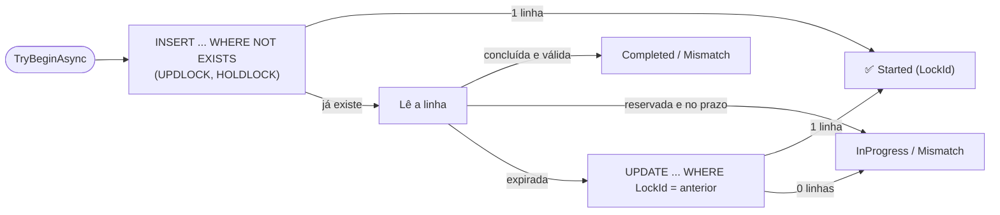

[🏠 TEC.ORM](../README.md) › [📚 Documentação](README.md) › Idempotência

# 🔂 Idempotência

> Guarda no banco da aplicação as respostas das requisições com `Idempotency-Key`, com reserva atômica: várias instâncias da API nunca executam a mesma operação duas vezes.

## 📑 Sumário

- [🎯 Visão geral](#-visão-geral)
- [🚀 Uso](#-uso)
  - [Mapear a tabela](#mapear-a-tabela)
  - [Registrar](#registrar)
  - [Limpeza](#limpeza)
- [⚙️ Opções](#️-opções)
- [❌ Erros](#-erros)
- [🛡️ Segurança](#️-segurança)
- [❓ Perguntas frequentes](#-perguntas-frequentes)

---

## 🎯 Visão geral

O `EfIdempotencyStore<TContext>` implementa o `IIdempotencyStore` do **TEC.Cqrs**, usado pelo middleware `UseTecIdempotency` do
`TEC.Cqrs.AspNetCore` (ver a [documentação da idempotência HTTP](https://github.com/tudoemcodigo/lib-tec-cqrs/blob/main/docs/idempotencia.md)).

| Tipo | Namespace | Para que serve |
|---|---|---|
| `modelBuilder.AddTecIdempotency(schema, tableName)` | `TEC.ORM.EntityFrameworkCore.Idempotency` | Mapeia a tabela no modelo do contexto |
| `services.AddTecOrmIdempotency<TContext>(...)` | `TEC.ORM.EntityFrameworkCore.DependencyInjection` (o `TEC.ORM.SqlServer.DependencyInjection` tem o mesmo método, que encaminha para este) | Registra o store (Scoped) e a limpeza |
| `EfIdempotencyStore<TContext>` | `TEC.ORM.EntityFrameworkCore.Idempotency` | O store (`TryBeginAsync`, `CompleteAsync`, `AbandonAsync`, `PurgeExpiredAsync`) |
| `OrmIdempotencyOptions` | `TEC.ORM.EntityFrameworkCore.Idempotency` | Opções da limpeza |

Os quatro provedores usam esses mesmos tipos; o SQL da reserva vem do dialeto do contexto (ver
[PostgreSQL, MySQL e Oracle](#postgresql-mysql-e-oracle)). O diagrama abaixo é o do SQL Server.



| Coluna | Tipo | Conteúdo |
|---|---|---|
| `Scope`, `IdempotencyKey` | `nvarchar(200) COLLATE Latin1_General_100_BIN2` no SQL Server (chave primária; a collation de cada banco está em [PostgreSQL, MySQL e Oracle](#postgresql-mysql-e-oracle)) | Escopo (no TEC.Cqrs, hash SHA-256 hex de 64 caracteres) e chave do cliente, comparados de forma **ordinal** (`Abc` ≠ `abc`), como exige o contrato do `IIdempotencyStore` |
| `RequestHash` | `varchar(128)` | SHA-256 da requisição |
| `LockId`, `State`, `LockedUntil` | — | Reserva (0 = em andamento, 1 = concluída) |
| `RetentionSeconds`, `ExpiresAt` | — | Retenção e expiração (índice em `ExpiresAt`) |
| `StatusCode`, `ContentType`, `HeadersJson`, `Body` | — | Resposta guardada |

---

## 🚀 Uso

### Mapear a tabela

```csharp
using TEC.ORM.EntityFrameworkCore.Idempotency;

public sealed class AppDbContext(DbContextOptions<AppDbContext> options) : DbContext(options)
{
    protected override void OnModelCreating(ModelBuilder modelBuilder)
    {
        modelBuilder.AddTecIdempotency(schema: "app");   // tabela app.IdempotencyKeys
    }
}
```

Depois gere e aplique a migration (`dotnet ef migrations add Idempotencia`).

> [!IMPORTANT]
> **Tabela criada sem a collation binária** (collation padrão do banco, em geral sem diferenciar maiúsculas): a próxima migration
> gerada traz um `AlterColumn` com a collation binária, mas o SQL Server não altera a collation de coluna que está na chave
> primária. Edite a migration para usar o script abaixo (a tabela só guarda respostas temporárias: se preferir, esvazie-a
> antes). Chaves que só diferem em maiúsculas passam a ser distintas.
>
> ```sql
> ALTER TABLE app.IdempotencyKeys DROP CONSTRAINT PK_IdempotencyKeys;
> ALTER TABLE app.IdempotencyKeys ALTER COLUMN Scope nvarchar(200) COLLATE Latin1_General_100_BIN2 NOT NULL;
> ALTER TABLE app.IdempotencyKeys ALTER COLUMN IdempotencyKey nvarchar(200) COLLATE Latin1_General_100_BIN2 NOT NULL;
> ALTER TABLE app.IdempotencyKeys ADD CONSTRAINT PK_IdempotencyKeys PRIMARY KEY (Scope, IdempotencyKey);
> ```

### Registrar

```csharp
builder.Services.AddTecOrm<AppDbContext>(o => o.ConnectionSecretName = "sql-app");
builder.Services.AddTecOrmIdempotency<AppDbContext>();

builder.Services.AddTecCqrs(o => o.RegisterServicesFromAssemblyContaining<Program>())
    .AddAspNetCore()
    .AddIdempotency();

app.UseAuthentication();
app.UseAuthorization();
app.UseTecIdempotency();
app.MapPost("/pedidos", ...).WithIdempotency();
```

### PostgreSQL, MySQL e Oracle

Os mesmos `AddTecIdempotency`, `AddTecOrmIdempotency<TContext>` e `EfIdempotencyStore<TContext>` servem aos quatro bancos. A
reserva usa o SQL do dialeto do contexto, com os nomes de coluna lidos do modelo (uma convenção que renomeie colunas, como
snake_case, continua funcionando), e as convenções do TEC.ORM trocam a collation binária do SQL Server pela de cada banco:

| Banco | Reserva atômica | Escopo e chave | Corpo da resposta |
|---|---|---|---|
| SQL Server | `INSERT ... WHERE NOT EXISTS` com `UPDLOCK, HOLDLOCK` | `Latin1_General_100_BIN2` | `varbinary(max)` |
| PostgreSQL | `INSERT ... ON CONFLICT (...) DO NOTHING` | `COLLATE "C"` | `bytea` |
| MySQL | `INSERT` simples na chave primária | `CHARACTER SET utf8mb4 COLLATE utf8mb4_bin` | `longblob` |
| Oracle | `MERGE INTO ... WHEN NOT MATCHED THEN INSERT` | sem collation de coluna (a comparação padrão do Oracle já é binária) | `BLOB` |

Só a violação de chave única de cada banco conta como "a chave já existe" (2627/2601, 23505, 1062/1586, ORA-00001); qualquer
outra exceção do `INSERT` (coluna inexistente, permissão negada, erro de sintaxe) sobe como erro, nunca vira `InProgress`.

> [!NOTE]
> - No MySQL, o `MySql.EntityFrameworkCore` ignora a collation relacional do EF Core ao gerar o DDL; por isso a convenção
>   grava também as anotações dele (`MySQL:Charset` e `MySQL:Collation`, as do `ForMySQLHasCollation`). O provedor grava
>   `DateTimeOffset` em `datetime` (UTC, sem fração de segundo): prazos e expiração ficam com precisão de segundos.
> - No Oracle, sem tipo explícito o provedor usaria `RAW(2000)` para o corpo e uma resposta maior não seria guardada.
> - O contexto precisa ter sido registrado por `AddTecOrm*` (é de lá que vem o dialeto). Para usar o store com um contexto
>   montado de outro jeito, passe o dialeto no construtor: `new EfIdempotencyStore<AppDbContext>(context, TimeProvider.System, new PostgreSqlDialect())`.

### Limpeza

Um `BackgroundService` remove, a cada `CleanupInterval`, as respostas fora da retenção e as reservas vencidas, em lotes de
`CleanupBatchSize` (até `MaxBatchesPerCleanup` por ciclo). Para limpar por um job próprio, desligue com `EnableCleanup = false` e chame
`EfIdempotencyStore<TContext>.PurgeExpiredAsync(batchSize, ct)`.

---

## ⚙️ Opções

| Opção | Padrão | Descrição |
|---|---|---|
| `EnableCleanup` | `true` | Limpeza periódica em segundo plano |
| `CleanupInterval` | 1 h | Intervalo entre limpezas (1 min a 1 dia) |
| `CleanupBatchSize` | 1.000 | Linhas por comando (1 a 10.000) |
| `MaxBatchesPerCleanup` | 50 | Lotes por ciclo (1 a 1.000) |

Retenção, prazo da reserva e limites de tamanho são do `IdempotencyOptions` do TEC.Cqrs.AspNetCore.

## ❌ Erros

| Exceção | Quando ocorre | O que fazer |
|---|---|---|
| `InvalidOperationException` "A tabela de idempotência não está mapeada" | Contexto sem `AddTecIdempotency()` | Mapeie a tabela e gere a migration |
| `InvalidOperationException` ao criar o store | Contexto sem dialeto (não registrado por `AddTecOrm*`) | Registre o contexto pelo provedor do banco ou passe o `ISqlDialect` no construtor |
| `InvalidOperationException` "Já existe um IIdempotencyStore registrado" | Dois stores (ex.: também `AddInMemoryIdempotencyStore`) | Registre um só |
| `ArgumentOutOfRangeException` | Opção fora dos limites | Corrija a opção |
| Log 3201 (Warning) | Falha na limpeza (banco indisponível) | Nada: tenta de novo no próximo ciclo |

## 🛡️ Segurança

> [!WARNING]
> A tabela guarda o **corpo das respostas** por até `Retention` (padrão 24 h). Se as respostas tiverem dados pessoais, trate a tabela
> como os demais dados da aplicação (backup, acesso, LGPD) e prefira respostas enxutas (ids e `Location`) nos endpoints idempotentes.

- O store nunca chama `SaveChanges`: só comandos diretos e leituras sem rastreamento. Alterações pendentes da aplicação no mesmo
  contexto não são gravadas por ele.
- Identificadores do SQL vêm do modelo (escapados); todos os valores são parâmetros.

## ❓ Perguntas frequentes

<details>
<summary><b>Posso usar um banco ou contexto separado?</b></summary>

Sim: mapeie a tabela em outro contexto registrado com `AddTecOrm<OutroContext>` e use `AddTecOrmIdempotency<OutroContext>()`.
</details>

<details>
<summary><b>O store participa da transação do command?</b></summary>

Participa da transação corrente do contexto, se houver. O middleware HTTP roda antes e depois do pipeline, fora de transação; por
isso a reserva fica visível às outras instâncias imediatamente.
</details>

---

⬅️ [🔁 Transação](transacao.md) · [📚 Índice](README.md) · [🔄 Mapeamento](mapeamento.md) ➡️
