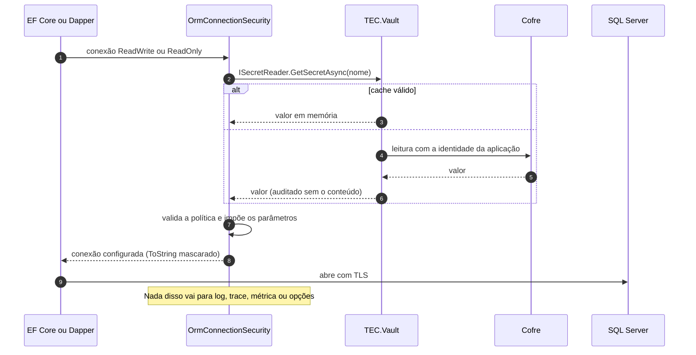

[🏠 TEC.ORM](../README.md) › [📚 Documentação](README.md) › 🛡️ Segurança

# 🛡️ Segurança

> Como o TEC.ORM aplica Zero Trust à persistência: a conexão só existe no cofre, toda entrada é parametrizada ou
> validada, nada sensível chega a logs, traces ou métricas, e o que fica sob responsabilidade de quem usa.

## 📑 Sumário

- [🎯 Visão geral](#-visão-geral)
- [🚀 Uso](#-uso)
  - [Ameaças e controles](#ameaças-e-controles)
  - [Fluxo da conexão segura](#fluxo-da-conexão-segura)
  - [O que nunca é registrado](#o-que-nunca-é-registrado)
  - [Responsabilidades de quem usa](#responsabilidades-de-quem-usa)
  - [Checklist de produção](#checklist-de-produção)
- [⚙️ Opções](#️-opções)
- [❌ Erros](#-erros)
- [🛡️ Segurança](#️-segurança-1)
- [❓ Perguntas frequentes](#-perguntas-frequentes)

---

## 🎯 Visão geral

| Princípio | Como o componente aplica |
|---|---|
| **Segredo só no cofre** | `UseSqlServer()` **sem** string de conexão; o interceptor pede ao `IOrmConnectionSecurity`, que lê do TEC.Vault antes de cada abertura |
| **Nunca confiar, sempre verificar** | Segredo com servidor e banco, `Encrypt` obrigatório, `TrustServerCertificate` só com opt-in; sempre impostos `Persist Security Info=False`, `Application Name`, `Command Timeout`; leitura com `ApplicationIntent=ReadOnly` |
| **Sem SQL injection** | CRUD 100% LINQ; `SortBy` em lista branca; leituras complexas só com `SqlQuery` (cada valor vira parâmetro); `SqlQuery.Parameters` somente leitura depois de validado |
| **Menor privilégio** | Segredo de leitura separado para um login só com `SELECT`; verificação de somente leitura como segunda barreira |
| **Assumir violação** | Conexão mascarada em trânsito; parse do segredo sem exceção registrada; `EnableSensitiveDataLogging` desligado; exceções de banco sem a mensagem original; eventos de erro do EF Core que a repetiriam desligados |
| **Limites contra abuso** | `MaxPageSize`, `MaxFindResults`, `MaxQueryRows` (comando cancelado no servidor), `CommandTimeoutSeconds`, tamanho e quantidade de parâmetros do `SqlQuery` |
| **Auditoria** | Escritas em `Information`, exclusão física em `Warning`; autoria gravada pela identidade com falha fechada |
| **Proteção contra *overposting*** | `ApplyTo`/`ToEntity` nunca gravam `Id`, exclusão lógica, auditoria, achatados ou somente leitura |

> [!IMPORTANT]
> A verificação de somente leitura é **defesa em profundidade**. A proteção principal das leituras complexas é o segredo
> de leitura ser de um login com permissão só de `SELECT`.

---

## 🚀 Uso

### Ameaças e controles

| Ameaça | Controle | Onde |
|---|---|---|
| Vazamento da string de conexão (repositório, imagem, `appsettings`, log) | Só no cofre; nunca nas opções; `ToString()` = `***`; `Persist Security Info=False` | `OrmConnectionSecurity`, `AddTecOrm` |
| Conexão sem criptografia / *man-in-the-middle* | `Encrypt=False`/`Optional` recusado; `TrustServerCertificate` só com opt-in e aviso 3103 | `OrmConnectionSecurity` |
| Injeção de SQL por valor | Parâmetros sempre (`@p0`, `@Nome`, `@__id_0`); `Parameters` imutável | `SqlQuery`, `OrmRepository.HasId` |
| Injeção ou inferência pela ordenação (`SortBy=PasswordHash`) | Lista branca `[Sortable]`; sem ela, só chave e datas de auditoria (`AllowUnmarkedSortBy = false`); sombra, exclusão lógica e tokens sempre recusados | `OrmRepository` |
| Escrita pela conexão de leitura | Verificação de somente leitura + login só com `SELECT`; no PostgreSQL, MySQL e Oracle, também a transação `READ ONLY` | `OrmQueryExecutor` |
| Negação de serviço por consulta enorme | `MaxQueryRows` com cancelamento no servidor; `MaxFindResults`; `MaxPageSize`; tempo limite | `OrmQueryExecutor`, `OrmRepository` |
| Vazamento em erros da API | Mensagens fixas; `ExternalService`/`Failure` ocultas do cliente | `OrmErrors` |
| Vazamento em logs (valor de chave duplicada, senha em erro de parse) | Exceções de banco sem mensagem; parse sem exceção registrada | `OrmOperationRunner`, `OrmConnectionSecurity` |
| Dados pessoais em telemetria | Traces e métricas sem identificador, SQL ou valores | `OrmDiagnostics` |
| Injeção de linhas ou falsificação visual no log pelo identificador | Controle, formatação (U+202E) e U+2028/U+2029 viram `?`, até 64 caracteres; ou `Hashed` (`<N caracteres, hmac:…>`) / `Omitted` | `OrmOperationRunner` |
| Repetição perigosa de escrita | Novas tentativas só em leituras fora de transação; `EnableRetryOnFailure` desaconselhado | `OrmOperationRunner` |
| *Overposting* | Regras do `ApplyTo`/`ToEntity` | Código gerado |
| Leitura de dados excluídos | Filtro global obrigatório | Convenção do TEC.ORM |
| Autoria falsa ou gravação anônima | Autoria só da identidade (cópia imutável no `UseTecOrm`); sem identidade, recusa | `AuditInterceptor` |
| Configuração insegura descoberta só em produção | Validação no `AddTecOrm` | `OrmOptions.Validate` |
| Acesso a dados por tenant | **Fora do escopo do ORM** (registros globais): decisão da aplicação | Aplicação |

### Fluxo da conexão segura

> [!CAUTION]
> **Conexão que já vem com servidor (`Data Source`) pula a política.** `UseSqlServer("Server=...")`,
> `UseSqlServer(connection)` ou uma conexão de ferramenta passam **sem** validação (intencional, para não sobrescrever uma
> escolha explícita). Em produção, deixe a conexão sempre vir do cofre.

### O que nunca é registrado

| Dado | Log | Trace | Métrica | Mensagem de erro |
|---|:---:|:---:|:---:|:---:|
| String de conexão, senha, servidor, banco | ❌ | ❌ | ❌ | ❌ |
| Nome do segredo | ❌ (fica na auditoria do TEC.Vault) | ❌ | ❌ | ❌ |
| Texto do SQL, valores de parâmetros e colunas | ❌ | ❌ | ❌ | ❌ |
| Mensagem original do banco | ❌ | ❌ | ❌ | ❌ |
| Identificador do registro | ✅ conforme `IdentifierLogMode` | ❌ | ❌ | ❌ |
| Entidade ou nome da consulta, operação, duração, código do erro | ✅ | ✅ | ✅ | código |

### Responsabilidades de quem usa

| O componente garante | Quem usa é responsável por |
|---|---|
| Conexão lida só do cofre | Guardar a conexão no cofre e dar à identidade da aplicação só leitura de segredos |
| Política do segredo | `Encrypt=True`/`Strict` e certificado válido; `AllowTrustServerCertificate` só em desenvolvimento |
| Parametrização | Nunca montar o texto do SQL antes de passar ao `SqlQuery` |
| Verificação de somente leitura | Login só com `SELECT` em `ReadOnlyConnectionSecretName` |
| Logs sem dados sensíveis | Não registrar entidades ou DTOs com dados pessoais; `IdentifierLogMode.Hashed` se a chave for dado pessoal |
| Exclusão lógica no EF Core | `IsDeleted = 0` no SQL próprio; reaplicar filtros ao usar `IgnoreQueryFilters()` |
| *Overposting* | `Id` da rota, autorização antes do `ApplyTo`, DTOs de entrada separados |
| Login da aplicação | Sem `db_owner`/`sysadmin`; migrations com outro login, fora da aplicação |
| Mesma versão | `TEC.ORM`, `TEC.ORM.EntityFrameworkCore` e o pacote do banco sempre na mesma versão (os satélites usam internos do núcleo) |

### Checklist de produção

- [ ] Conexões de escrita e de leitura no cofre, com `Encrypt=True` e sem `TrustServerCertificate=True`.
- [ ] `ReadOnlyConnectionSecretName` aponta para um login só com `SELECT`.
- [ ] `AllowTrustServerCertificate = false`.
- [ ] Nenhum `UseSqlServer("Server=...")`/conexão pronta no contexto.
- [ ] `[Sortable]` nas entidades cujo `SortBy` vem da requisição.
- [ ] Cache do TEC.Vault (`EnableSecretCache`) com duração compatível com a rotação de senha.
- [ ] `IdentifierLogMode.Hashed` ou `Omitted` se alguma chave for dado pessoal.
- [ ] Logs do TEC.ORM em `Information`; alerta para os eventos 3004 e 3007.
- [ ] Sem `EnableRetryOnFailure` no `AddTecOrm`.
- [ ] Health check `tec-orm` no readiness; imagem com ICU.
- [ ] `TEC.ORM`, `TEC.ORM.EntityFrameworkCore` e o pacote do banco na mesma versão.

### Provedores PostgreSQL, MySQL e Oracle

Os quatro provedores (`AddTecOrm`, `AddTecOrmPostgreSql`, `AddTecOrmMySql`, `AddTecOrmOracle`) usam o mesmo registro do
`TEC.ORM.EntityFrameworkCore` (`AddTecOrmDbContext`): identidade da auditoria pelo `ICurrentUser`, interceptores na ordem
conexão → exclusão lógica → autoria → trilha histórica, convenções, `EnableSensitiveDataLogging(false)`, eventos de erro do
EF Core que repetiriam a mensagem do banco desligados (`CommandError`, `ConnectionError`, `SaveChangesFailed`...),
`CommandTimeout` nos comandos, `IExceptionErrorMapper` do TEC.Cqrs e `DefaultOrmAuditContextProvider` com o `ICurrentUser`.
O que muda de um banco para outro é o dialeto:

| Item | PostgreSQL | MySQL / MariaDB | Oracle |
|---|---|---|---|
| Recusado no segredo | `SslMode` `Disable`, `Allow`, `Prefer` | `SslMode=Disabled` (ou `None`) | descritor com algum `ADDRESS` sem `PROTOCOL=TCPS`; EZConnect sem `tcps://` (espaços, tabulações e quebras de linha são normalizados antes da verificação) |
| Só com `AllowTrustServerCertificate` (aviso 3103) | `SslMode=Require`, que no Npgsql 6 ou superior cifra sem validar o certificado | `Preferred` e `Required` (não validam o certificado; `Preferred` ainda volta a conexão sem TLS) | os casos acima e `SSL_SERVER_DN_MATCH` desligado |
| Impostos | `Persist Security Info=False`, `Include Error Detail=False`, `Application Name`, `Command Timeout` | `Persist Security Info=False`, `AllowLoadLocalInfile=false`, `Default Command Timeout` (sem `Application Name`: o MySql.Data não tem a chave) | `Persist Security Info=False` (o `Connection Timeout` do segredo fica como está) |
| Conexão de leitura | `Enlist=false` | `AutoEnlist=false`, `ConnectionReset=true` | `Enlist=false` |
| Transação das leituras do Dapper | `SET TRANSACTION READ ONLY` | `START TRANSACTION READ ONLY` | `SET TRANSACTION READ ONLY` |
| Não inspecionado | — | — | alias do `tnsnames` (sem protocolo na string) e criptografia nativa do Oracle Net: a política do alias é de quem o mantém |

A transação `READ ONLY` é aberta antes de cada consulta do `IOrmQueryExecutor` e desfeita no fim: mesmo que um SQL de
escrita passe pelo validador (ou com `EnforceReadOnlyQueries = false`), o banco recusa a escrita. O SQL Server não tem
transação somente leitura; lá a barreira continua sendo o login de leitura só com `SELECT`, com `ApplicationIntent=ReadOnly`.

O validador somente leitura é uma lista de palavras proibidas, como no SQL Server, e continua sendo defesa em profundidade:
use um login com permissão só de `SELECT`. Ele remove literais e comentários, exige que o SQL comece com `SELECT` ou `WITH` e
recusa um segundo comando depois de `;`. Diferenças e limites do que ele reconhece:

| Dialeto | Recusado | Não é recusado |
|---|---|---|
| PostgreSQL | `INSERT`, `UPDATE`, `DELETE`, `MERGE`, `TRUNCATE`, `INTO`, `CREATE`, `ALTER`, `DROP`, `GRANT`, `REVOKE`, `EXECUTE`, `PREPARE`, `DEALLOCATE`, `CALL`, `DO`, `COPY`, `VACUUM`, `ANALYZE`, `REINDEX`, `CLUSTER`, `CHECKPOINT`, `LOCK`, `BEGIN`, `COMMIT`, `ROLLBACK`, `SAVEPOINT`, `SET`, `RESET`; as funções `PG_SLEEP*`, `PG_READ_FILE`, `PG_READ_BINARY_FILE`, `PG_WRITE_FILE`, `PG_WRITE_BINARY_FILE`, `DBLINK`, `DBLINK_EXEC`, `DBLINK_CONNECT`, `DBLINK_SEND_QUERY`, `LO_IMPORT`, `LO_EXPORT`, `LO_UNLINK`, `LO_CREATE`, `LO_FROM_BYTEA`, `LO_PUT`, `SET_CONFIG`, `NEXTVAL`, `SETVAL`, `PG_TERMINATE_BACKEND`, `PG_CANCEL_BACKEND`, `PG_RELOAD_CONF`, `PG_NOTIFY` e as que começam com `PG_ADVISORY_` ou `PG_TRY_ADVISORY_`, também entre aspas; `FOR UPDATE`, `FOR SHARE` e `FOR KEY SHARE` | funções de usuário com efeito colateral |
| MySQL / MariaDB | `UPDATE`, `DELETE`, `MERGE`, `INTO`, `CREATE`, `ALTER`, `DROP`, `GRANT`, `REVOKE`, `EXECUTE`, `PREPARE`, `DEALLOCATE`, `CALL`, `LOCK`, `UNLOCK`, `BEGIN`, `COMMIT`, `ROLLBACK`, `SET`, `LOAD`; `INSERT`, `REPLACE` e `TRUNCATE` como comando; as funções `LOAD_FILE`, `SLEEP`, `BENCHMARK`, `GET_LOCK`, `RELEASE_LOCK`, `RELEASE_ALL_LOCKS`, `MASTER_POS_WAIT`, `SOURCE_POS_WAIT`, `WAIT_FOR_EXECUTED_GTID_SET`, também entre crases; `FOR UPDATE`, `FOR SHARE`, `LOCK IN SHARE MODE` e comentários `/*! */` e `/*M! */` | `REPLACE()`, `TRUNCATE()` e `INSERT()` usados como funções; funções de usuário com efeito colateral |
| Oracle | `INSERT`, `UPDATE`, `DELETE`, `MERGE`, `TRUNCATE`, `INTO`, `CREATE`, `ALTER`, `DROP`, `GRANT`, `REVOKE`, `EXEC`, `EXECUTE`, `DECLARE`, `BEGIN`, `COMMIT`, `ROLLBACK`, `SAVEPOINT`, `LOCK`, `CALL`, `FOR UPDATE`; `DBMS_*`, `UTL_*` e `HTTPURITYPE` em qualquer parte de um nome qualificado (`SYS.DBMS_LOCK`) e entre aspas (`"SYS"."DBMS_LOCK"`) | sinônimos criados no banco para esses pacotes e funções de usuário com efeito colateral |

Fora as exceções do MySQL acima, as palavras valem em qualquer posição: uma coluna chamada `set` ou `do` precisa de aspas.

> [!NOTE]
> **Suporte implementado, validação de integração pendente.** PostgreSQL, MySQL e Oracle têm testes unitários, de registro
> no container e de integração (`ProviderIntegrationTests`), mas os de integração ainda não rodaram contra os bancos reais
> ([🧪 Testes](testes.md)).

---

## ⚙️ Opções

| Opção | Padrão seguro | Quando mudar |
|---|---|---|
| `AllowTrustServerCertificate` | `false` | Só desenvolvimento local |
| `EnforceReadOnlyQueries` | `true` | Nunca, salvo login de leitura comprovadamente só com `SELECT` |
| `IdentifierLogMode` | `Auto` | Chave texto já com HMAC; `Hashed`/`Omitted` para esconder também chaves técnicas |
| `MaxPageSize` / `MaxFindResults` / `MaxQueryRows` | 100 / 1.000 / 10.000 | Reduza em APIs públicas |

---

## ❌ Erros

| Código | Relação com segurança |
|---|---|
| `ORM_CONEXAO_INVALIDA` | Segredo fora da política (motivo no log 3101, sem valores) |
| `ORM_CONSULTA_NAO_PERMITIDA` | SQL de escrita bloqueado na conexão de leitura |
| `ORM_ENTRADA_INVALIDA` | `SortBy` fora da lista branca, parâmetros inválidos |
| `ORM_LIMITE_EXCEDIDO` | Consulta acima dos limites |
| `ORM_CONEXAO_INDISPONIVEL` | Identidade sem acesso ao segredo ou login recusado |
| `ORM_AUDITORIA_SEM_IDENTIDADE` | Gravação auditada sem identidade (falha fechada) |

---

## 🛡️ Segurança

Cadeia de suprimentos e build (padrões do [tec-workflows](https://github.com/tudoemcodigo/tec-workflows)):

- `packageSourceMapping`: `TEC.*` **nunca** vêm do nuget.org (contra *dependency confusion*).
- `packages.lock.json` versionado e restore `--locked-mode`; `NuGetAudit` com vulnerabilidade como erro.
- Analisadores de segurança como erro; no `TEC.ORM`, também os avisos de trimming/AOT.
- CodeQL `security-extended` em todo PR, dentro do CI central (alerta ≥ 7,0 bloqueia).
- Testes de segurança: fuzzing, fuzzing diferencial contra o parser do T-SQL, DoS, vazamento e injeção com tabela-canário
  ([🧪 Testes](testes.md)).

> [!CAUTION]
> Vulnerabilidades: não abra *issue* pública; escreva para [roberto@roberto.inf.br](mailto:roberto@roberto.inf.br).

---

## ❓ Perguntas frequentes

O ORM isola dados por tenant?

Não. O tenant é só auditoria; os registros são globais. Use filtros globais próprios (ex.: filtro nomeado no EF Core 10) e
autorização na aplicação.

Posso usar autenticação do Entra ID (sem senha) no SQL?

Sim: implemente `IOrmConnectionSecurity` (ex.: token de acesso na `SqlConnection`) e registre antes do `AddTecOrm`
([🗄️ SQL Server](sqlserver.md#extensão-e-substituição)).

---
⬅️ [❌ Erros](erros.md) · [📚 Índice](README.md) · [🧪 Testes](testes.md) ➡️
